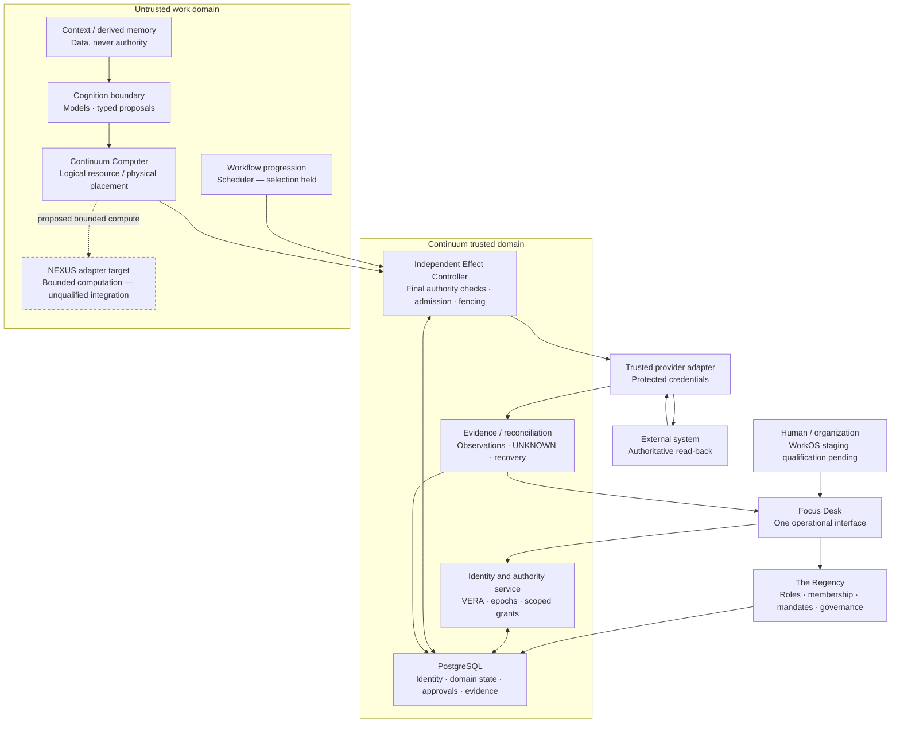
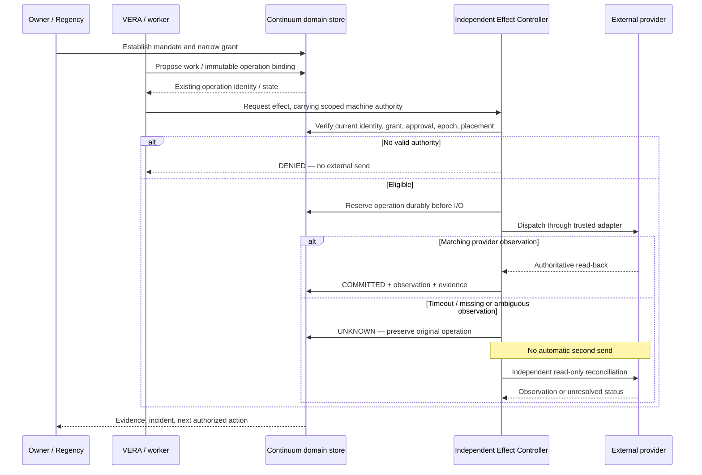

# Continuum

> **Implementation import:** the recovered codebase is now included for review. Read [import provenance and verification status](docs/import/GITHUB-IMPORT.md) and the [recovered implementation guide](docs/import/RECOVERED-README.md). This is a development baseline, not production or live-model approval.

### A persistent, governed operating environment for autonomous intelligence.

**Continuum, by Asentxia Systems** · **Architecture:** Distributed Cognitive Architecture (DCA) · **Principal:** VERA · **Governance:** The Regency

> **The principal persists. The components may change.**
>
> A model is not an identity. A session is not a lifetime. A tool connection is not permission. A successful API response is not necessarily a verified outcome.

**Project status:** Active development · Locally validated components and integration slices · **Production: BLOCKED** · **Scheduler selection: HELD** · **Canary: NO-GO**

[Architecture](#architecture-topology) · [Why Continuum](#the-infrastructure-gap) · [Capabilities](#system-capabilities) · [Evidence](#implementation-and-evidence-status) · [Developer setup](#development-and-local-verification) · [Roadmap](#roadmap) · [Research](#frontier-research-directions)

---

## Abstract

Autonomous software is moving from bounded question-answering into sustained operation: maintaining work across time, accessing persistent resources, coordinating other workers, and making consequential changes to external systems. Yet the operating identity of many agent implementations remains entangled with ephemeral model sessions, processes, credentials, workflow instances, and machines. Memory is frequently confused with truth; tool availability with authority; workflow completion with real-world completion. A more capable model does not, by itself, repair these systems boundaries.

**Continuum** is Asentxia's implementation program for **Distributed Cognitive Architecture (DCA)**: an operating architecture organized around a persistent, identifiable, accountable autonomous principal rather than a transient inference session. The principal, **VERA** (*Verifiable Entity with Revocable Authority*), is distinct from the model providing cognition, the Computer providing an environment, the credentials presenting identity, and the workers executing tasks. Continuum connects durable state, scoped and revocable authority, isolated execution, effect mediation, recovery, independently inspectable evidence, and governed coordination. The intended result is autonomy that can continue within defined authority across component changes **without treating adaptation as permission escalation**. That end state is an architectural objective, not a claim that every failure mode or integration has already been qualified.

**The architectural distinction:** agent frameworks chiefly organize *how tasks are attempted*; Continuum specifies *which principal is responsible, which state is authoritative, what may be done, which system may do it, and what evidence is required to declare an outcome*.

---

## The infrastructure gap

A long-running agent is not merely a longer-running chat session. Once software can act, the following become operating-system and distributed-systems problems.

| Existing failure mode | Why it matters | Continuum's architectural response | Present boundary |
|---|---|---|---|
| **Session-bound identity** | Restarts and model changes can sever responsibility, permissions, and history. | VERA: a durable principal ID separated from model, worker, credential, and Computer identity. | Local identity and same-host reconstitution slices; broad portability remains unqualified. |
| **Disposable execution** | Work, files, browser state, and recovery intent are lost or inconsistently reconstructed. | Logical **Continuum Computer**, placement generations, persistent records, and recovery fences. | Local continuity/fencing; managed host-loss and migration gates remain open. |
| **Ambient tool authority** | An available integration is mistaken for permission to mutate real systems. | Scoped grants, exact approvals, principal epochs, expiry, and independent effect enforcement. | Local enforcement tests; real provider/identity qualification pending. |
| **Uncontrolled retries** | A timeout can cause the same external action to be sent twice. | Durable operation identity, reserve-before-send, `UNKNOWN`, and authoritative reconciliation without blind resend. | Exercised with local fixtures; heterogeneous live sink behavior remains unqualified. |
| **Memory without epistemic controls** | Retrieved or generated content can be promoted into trusted facts or executable authority. | Authoritative admission, source/digest checks, quarantine, retention controls, and derived memory kept separate from grants. | Narrow local context path; full governed recall and ingestion integration pending. |
| **Self-reported success** | A model can assert completion without an externally corroborated result. | Independently collected provider observations, domain transitions, and inspectable evidence. | Local proof surface; external verification adapters/anchors pending. |
| **Coordination without ownership** | Agent handoffs can obscure who can act, for whom, and against which resources. | Versioned mandates, membership, durable tasks, separate principal identities, governed handoffs. | Initial work admission merged; full collectives and delegation are future work. |
| **Human-only interaction paths** | Browsers, GUI scripting, and repeated translation add operational work when structured interfaces exist. | Machine-oriented, typed, versioned control and effect interfaces behind explicit authority gates. | Design direction; no general zero-latency or universal GUI-elimination claim. |

### What this enables

Continuum is being built so that a single accountable autonomous worker can **retain a durable identity, accept bounded work, run in a defined environment, request permission where required, survive an interruption, inspect an uncertain outcome, and resume without silently gaining authority or duplicating an external effect**.

On that foundation, the longer-range program supports:

- **Long-duration autonomous work:** agents that carry task state, artifact lineage, and operational responsibility beyond one inference call or worker process.
- **Replaceable cognition:** change a model binding without declaring a new principal or automatically inheriting fresh authority. Behavioral compatibility remains a separate verification question.
- **Recoverable environments:** replace a lost worker or placement while preserving logical ownership and preventing stale placements from acting.
- **Governed action:** let low-risk work progress under existing permission while consequential actions require their exact applicable grants and approvals.
- **Auditable outcomes:** distinguish proposed, permitted, sent, observed, reconciled, and independently accepted results.
- **Sovereign deployment choices:** preserve explicit boundaries between principal, provider, environment, state, and operator, so architecture does not depend on one model or one machine vendor. Actual deployment portability must be demonstrated per provider.
- **Multi-principal institutions:** enable teams of autonomous principals to coordinate under membership and mandates without pooling their authority by default.
- **Machine-native interoperability:** build toward direct structured exchanges and federated interaction, with authorization enforced by the receiving runtime rather than presumed from network identity.

These are **capability objectives**. The implementation table below identifies what has been exercised, what is incomplete, and what has not been tested.

---

## Core topology: DCA

**Distributed Cognitive Architecture (DCA)** is Asentxia's reference architecture for persistent, governed autonomous intelligence. It is **not** an established external industry standard, a new foundation model, or a requirement that every component be decentralized. It defines **seven system responsibilities** and a cross-cutting **Effect Boundary**.

| DCA responsibility | Contractual question | Continuum realization / direction |
|---|---|---|
| **1. Environment** | Where can this principal run; what resources and isolation apply? | Continuum Computer, ComputerService/provider boundary, isolated placements and lifecycle. |
| **2. State** | What survives; who owns it; which information is admissible? | PostgreSQL domain truth, versioned context/artifacts, provenance-aware memory. |
| **3. Authority** | Who may act, on what, for how long, and under which versions? | VERA identity, grants, exact approvals, principal epochs, Regency governance. |
| **4. Execution** | How are proposed actions safely transformed into permitted work? | Constrained computation and independent, credential-bearing Effect Controller. |
| **5. Evidence and recovery** | How are results observed, failures represented, and continuity restored? | Domain/evidence records, provider read-back, `UNKNOWN` reconciliation, recovery fencing. |
| **6. Coordination** | How is work exchanged without merging rights or responsibility? | Tasks, mandates, organizations, handoffs, future VERA collectives. |
| **7. Cognition boundary** | How can model outputs inform work without becoming authority? | Versioned model/context/tool bindings, validated plans, replaceable cognition gateway. |

> **System invariant:** The **Effect Boundary is not an eighth DCA responsibility**. It crosses architecture layers at the transition from *proposed intent* to *consequential external effect*. Models, schedulers, dashboards, and memory stores cannot bypass it merely because they can describe or request an action.

### Architecture topology



**Trust is not transitive.** A verified human sign-in does not mint an agent capability; a task assignment does not mint an effect grant; a computational sandbox token does not grant an external mutation; an approved operation does not prove its outcome; and an evidence-chain hash does not establish that an external system actually changed.

### Distinct identities and ownership

| Entity | Durable meaning | Must not be confused with |
|---|---|---|
| **VERA** | The accountable autonomous principal, with a stable principal ID. | A model, conversation, worker PID, credential, VM, or Computer. |
| **Workload identity** | An enrolled machine identity with its own version, validity, and binding. | A human browser session or the VERA itself. |
| **Continuum Computer** | A logical computing resource assigned to an authorized operating context. | One physical host, one process, or one provider VM. |
| **Placement** | A particular deployment of a Computer, carrying its own generation/fence. | The Computer's durable identity. |
| **Task / operation** | Work objective versus one immutable proposed external action. | Permission to send, or externally verified success. |
| **Grant / approval** | A narrow authorization record with revocation and version semantics. | A role, mandate, available tool, or scheduler event. |

### The operating sequence



**External truth belongs to the provider.** Continuum stores decisions and observations; the scheduler advances work; the Effect Controller is the trusted enforcement boundary. These responsibilities are intentionally separated so no model or UI component can certify its own real-world effect.

---

## System capabilities

### 01 / VERA — persistent autonomous principal

A VERA is an accountable system identity whose continuity is not equated with the current inference engine. Its history, admitted state, operating assignments, and authority are individually versioned. A model substitution may retain the principal ID while requiring renewed eligibility, semantic binding checks, and independent validation of behavior.

**Why it matters:** continuity becomes a property of durable system state and trusted identity, not an incidental property of the process that happened to run a model.

### 02 / Continuum Computer — an environment with a logical lifetime

A Continuum Computer is separate from the physical placement currently serving it. The design supports explicit lifecycle, health, bounded resources, generation-based fencing, and reconstruction from authorized durable state. The Computer provider supplies compute; it does not become the root of effect authority.

**Why it matters:** infrastructure changes need not erase operational identity, and a recovered old host must not silently become an authorized sender.

### 03 / The Regency — governance without implicit superpowers

The Regency governs organizations, members, roles, mandates, operator decisions, and bounded authorizations through Continuum's authoritative domain records. Its **Focus Desk** presentation is a human client, not a second authority database or root execution service.

A role is not a grant. A mandate is not a grant. An approval is not an effect. In the current v1 policy, **agents may work within supplied permission but cannot create, expand, or transfer external-effect authority**. Future delegation requires a separate contract and review.

### 04 / Effect Boundary — consequential actions require independent permission

The Effect Controller executes the final trusted checks before consequential operations. Its binding includes the acting principal, current epoch and placement generation, exact target/action/parameters, relevant manifest revisions, applicable grant and approval versions, and a stable operation identity.

The controller is separate from the worker and owns access to fixed provider adapters. Worker code and model output are not trusted to hold provider-wide credentials or make permission decisions.

**Why it matters:** prompt instructions cannot serve as the security boundary for real-world authority.

### 05 / Durable operations — uncertainty is an explicit state

Continuum separates *authorization to attempt an effect* from *observation that an effect happened*. A durable reservation precedes provider I/O; duplicate delivery cannot create a second sender for the same logical operation in the tested protocol. A lost response or ambiguous failure becomes `UNKNOWN`, rather than a success badge or a blind retry.

Reconciliation reads the original provider state where a qualifying read-back contract exists. Missing data does not prove non-execution. General exactly-once execution across arbitrary external systems is **not guaranteed**.

### 06 / Context, artifacts, and governed memory

The architecture separates admitted facts and authoritative domain state from derived memory, retrieval indexes, model-supplied assertions, and untrusted source content. Durable context requires explicit ownership, version, source/digest, isolation, quarantine, invalidation, and eventually retention/erasure semantics.

**AEON-IQ** is the approved *restricted derived-memory integration direction*; it is **not** a qualified live Continuum integration. PostgreSQL and Continuum admission remain authoritative. A retrieved memory can inform a proposal; it cannot change permissions by being retrieved.

### 07 / Constrained computation

Bounded execution protects the system from untrusted code independently of the model's intent. **NEXUS**, a capability-oriented WASM execution system, is the approved direction for restricted, pinned computation adapters. Its integration must demonstrate limits on modules, paths, fuel, memory, time, and credential reachability.

The ordinary filesystem/application workspace is **not** automatically equivalent to the NEXUS WASM security boundary. NEXUS tests in its own repository are not end-to-end Continuum proof.

### 08 / Evidence, provenance, and recovery

Operational evidence is separate from the worker's explanation of what occurred. A useful record includes the actor and scope, immutable action binding, authority decision, dispatch state, provider observation, failure/reconciliation state, version, and trace lineage. Hash-linked event integrity is useful but must not be confused with external outcome truth or tamper resistance against privileged administrators without independent anchoring.

Recovery is fail-closed: restored data alone must not reactivate sending; placement and deployment fences must rotate, possible effects must be reconciled, and stale identities must stay invalid.

### 09 / Coordinated work and durable organizations

Continuum models organizations, memberships, mandates, tasks, assignments, and future handoffs explicitly. An early merged work-admission slice requires eligible organization membership and a current mandate. Creating a task does **not** start a workflow, grant permission, or perform an external effect.

Longer-range **VERA Collectives** and **VERA Organizations** will coordinate multiple independently accountable principals. Coalition safety, recursive delegation, and organization-invariant authority are research and future implementation obligations, **not** current multi-agent production guarantees.

### 10 / Focus Desk — a usable human operating boundary

The planned product experience begins with **Work**, not a wall of infrastructure telemetry: urgent conditions, approvals that genuinely need attention, blocked work, active tasks, and results awaiting review. A contextual inspector connects each item to its VERA, Computer, exact action, authority, evidence, and recovery state.

The intended navigation covers **Work, Projects, Agents/VERA, Computers, Approvals, Evidence, Recovery, and Settings**, with supporting views for authority, context, integrations, incidents, security, and usage where qualified. Unsupported functions remain disabled or explicitly unavailable; simulated readiness and optimistic success are not acceptable substitutes for server-derived status.

---

## Development and local verification

**No installer or released runtime is yet published in this official repository.** The maintained development repository contains a guarded local qualification harness. The following commands refer to that development source, **not** to a ready-to-deploy Continuum distribution.

**Development prerequisites:** Linux environment with working local UID/network namespace privileges; backend Node.js 24, separate frontend Node.js 22, PostgreSQL 17 tooling, Python 3, OpenSSL, Chromium, and the versions pinned by the repository lockfile. Configure the binaries in the manner documented in the maintained source. The test harness uses disposable local fixtures and refuses known live/staging database profiles.

```bash
# Read the current development-source README and testing contract before running.
git clone https://github.com/Adaptive-Liquidity/notion-continuum.git
cd notion-continuum

# Set these to existing local binary directories/paths (no automatic installs).
export CT_PG_BIN=/path/to/postgresql17/bin
export CT_NODE22_BIN=/path/to/node22/bin
export CT_CHROMIUM_PATH=/path/to/chromium
export PATH="$CT_PG_BIN:$PATH"  # backend Node 24 remains the active node

npm ci --ignore-scripts

# Explicitly authorizes resets ONLY of the named disposable LOCAL fixtures.
CT_RESET_LOCAL_FIXTURE=yes CT_RESET_CONSOLE_FIXTURE=yes npm run test:canonical

# Local-only console, with TEST identities and non-live actions.
# Startup preserves ct_console_dev. Reset is a separate confirmed command:
# CT_RESET_CONSOLE_FIXTURE=yes npm run dev:console:reset
npm run dev:console
```

**Do not use these reset flags against a shared, staging, or production database.** The maintained source contains additional local-environment safeguards and test instructions. A local UI session does not establish actual WorkOS authentication, a live Computer entitlement, or authority for an external effect.

For scoped product-build checks, the maintained repository documents:

```bash
npm run build:product
npm run typecheck:console
npm run test:console
npm run build:console
```

The commands above are documented from that repository; **they have not been executed for this README preparation**. A source archive or open repository without a deliberate license must not be treated as a redistributable production SDK.

---

## Performance invariants and execution limits

### Safety contracts

The following are **specified safety conditions**, exercised only within the qualifying boundaries stated in the evidence table. They are not proofs of universal correctness, perfect isolation, or an unbounded distributed-system guarantee.

1. **Authority precedes effect admission.** Every protected send must resolve to current, scope-matching identity, grant, policy, approval when required, and placement/version checks.
2. **Revocation is ordered against new admission.** An admission serializing after a committed revocation is denied. A request already admitted or in flight might still complete; global recall is not promised.
3. **Effect identity is immutable.** Reusing an operation identifier or idempotency binding with changed action parameters is a conflict, not a new send.
4. **Reserve before I/O.** A logical operation is durably reserved before any potential external mutation. Concurrent deliveries and crash recovery must not open a second send path.
5. **Unknown is not failed.** An uncertain external outcome cannot be retried blindly. It requires authoritative read-only reconciliation or operator escalation.
6. **Provider observation is required for verified completion.** An API acknowledgement, worker report, and hash-chain continuity do not independently prove a committed external result.
7. **Recovery cannot restore old authority.** A database restore or Computer reconstruction remains blocked until independent fencing and effect reconciliation requirements are met.
8. **State and memory are not authority.** Retrieved facts, context, tool availability, organizational roles, and model-generated instructions cannot mint protected grants.
9. **Isolation is explicit.** Tenant-qualified objects, trusted credential custody, controlled egress, and separate worker/controller trust domains are independently qualified at each deployment boundary.
10. **Resource use is bounded where controls exist.** Scope, expiry, deadlines, reservations, and budgets must fail closed; unmeasured token, money, and cloud costs are not represented as verified limits.

### Conditional formal statements

With the local protocol assumptions—trusted PostgreSQL commit behavior, protected controller and credentials, immutable operation binding, correct lock/fence enforcement, and no alternate provider-effect channel—the intended properties can be stated as:

```text
Admit(operation)
  => CurrentIdentity
     ∧ CurrentGrant
     ∧ MatchingActionAndResource
     ∧ CurrentPrincipalEpoch
     ∧ CurrentPlacementGeneration
     ∧ RequiredApprovalSatisfied

UNKNOWN(operation) => NOT AutomaticallyResend(operation)

COMMITTED(operation)
  => Exists(MatchingAuthoritativeProviderObservation(operation))

CommittedRevocationBeforeAdmission(operation)
  => NOT Admit(operation)
```

These statements specify what to test. They do not prove that a malicious host, misconfigured provider adapter, compromised trusted controller, or unrelated out-of-band credential can never produce an effect. The actual external at-most-once property depends on the full sink and recovery model; no universal exactly-once claim is made.

### Build and execution limits

Continuum does not assume that an autonomous principal should receive unrestricted hardware or permanent compute. The intended execution contract includes quotas for CPU, memory, disk, network, concurrency, work duration, API operations, and monetary cost **where the supporting provider and metering controls can enforce them**. Resource ceilings and recovery-time objectives must be accepted against measured workloads; no universal numerical bounds have been approved.

For any evaluated workload, report at minimum:

| Measurement | Required interpretation |
|---|---|
| End-to-end p50/p95/p99 latency | From admitted work to independently observed outcome; include waiting, model, provider, and reconciliation time. |
| Successful operations per second | Count only outcomes meeting their actual verification contract. |
| Authorization and evidence overhead | Incremental CPU, storage writes, allocations, network hops, and tail latency against a comparable incumbent. |
| Duplicate / stale send rate | Under retries, expiry, revocation races, crash points, and restore scenarios. |
| Persistent footprint | Domain records, artifacts, derived indexes, event growth, and per-principal idle cost. |
| Recovery | RPO/RTO only where measured and approved, plus stale-host denial and unresolved effects. |
| Unit economics | Model tokens + compute + storage + bandwidth + control-plane overhead + human review + reconciliation. |

> **Efficiency thesis, not a benchmark:** typed machine interfaces can avoid unnecessary GUI emulation and repeated session reconstruction, but authorization, isolation, and evidence remain necessary costs. Continuum's advantage must be measured end-to-end against a competent durable-workflow and agent-platform baseline. No verified sub-millisecond, zero-latency, or industry-leading throughput claim is asserted here.

---

## Implementation and evidence status

**Snapshot basis:** maintained Continuum development repository (`main` observed at `9436058b1caefad58ea35e6917dc8978be1fd844`) and published engineering plan reviewed **2026-10-15**; the plan's documented implementation/merge checkpoint is **2026-10-12**. The table is deliberately about *what is evidenced*, not what architecture intends.

| Surface | Evidence-backed current scope | Unresolved qualification |
|---|---|---|
| **Domain and authority** | PostgreSQL-backed identities, exact scoped approvals/grants, local isolation checks, controller regression paths. | Real identity provider, live service identity, full deployment isolation, independent security review. |
| **Operation safety** | Local fixture exercises durable reservation, duplicate suppression, revocation/fence checks, `UNKNOWN`, read-back and recovery restrictions. | Live protected external mutation, provider idempotency/read-back semantics, host/service failure matrix. |
| **VERA and Computer continuity** | Same-host process-restart demonstration and local identity/placement-generation slices. | Physical host loss/migration, multi-Computer, regional recovery, universal model substitution. |
| **Regency / work model** | Local organization/mandate/member records; merged task-admission and tool-manifest revision slices. | Complete projects/handoffs, collectives, approval workflows and their production APIs. |
| **Focus Desk** | Authenticated product-interface implementation and local frontend/build/browser checks. | Real WorkOS/AuthKit staging identity, managed lifecycle input, accessibility independent review, release qualification. |
| **Context and memory** | Narrow versioned context, quarantine/digest, artifact integrity and local isolation paths. | Governed AEON-IQ adapter, semantic truth/recall, complete retention/erasure review. |
| **Constrained execution** | NEXUS standalone evaluation evidence exists at a pinned source; integration direction approved. | Continuum NEXUS adapter, isolated credential boundary, end-to-end negative testing. |
| **Scheduler** | Reference-only evaluation of pg-boss and Temporal and limited fixture continuity. | Measured final choice, 24-hour staging and incompatibility/recovery qualification. **HELD.** |
| **Live release** | Local canonical development verification has been recorded in the maintained repository. | Live P1–P5 and mandatory R-gates; independent review, shadow and canary. **Production BLOCKED; canary NO-GO.** |

A **September 2026 proof package** reported preservation of the same VERA and Continuum Computer IDs, durable state, scoped grant behavior, revocation denial, a mediated post-restart operation, ordered records, and independent checking **across same-host process restart only**. This is a bounded historical evidence statement, not an independently rerun test in this README and not proof of host migration or production availability.

**Verified here:** repository metadata and current documents were read. **Not executed here:** a fresh local build, independent vulnerability audit, workload benchmark, staging deployment, managed VM crash, real protected-provider action, or production canary.

### Evidence and maturity policy

All significant public performance, security, and reliability claims should link to a versioned record that names **claim ID, exact statement, source commit, environment, method, positive and negative test artifacts, date, limitations, and explicitly excluded conclusions**. A paper is not implementation proof; an isolated dependency benchmark is not Continuum end-to-end performance; a passing local test is not production certification.

**Current maintained development source:** [Adaptive-Liquidity/notion-continuum](https://github.com/Adaptive-Liquidity/notion-continuum) (engineering code and source-controlled plan; separately governed from the official presentation repository). **Official Continuum repository:** [Adaptive-Liquidity/continuum-official](https://github.com/Adaptive-Liquidity/continuum-official). Public GitHub visibility does **not** imply an open-source license, production availability, or permission to redistribute third-party integrations.

---


## Roadmap

The roadmap is **evidence-gated rather than calendar-promised**. Work can advance only when its specific contract, trust boundary, test scope, and required owner decisions are satisfied. An architectural direction or merged design document is not an implementation or deployment approval.

### Track A — establish the governed single-principal product

**Stage A0 · Local foundations — partially implemented / locally exercised**

- Durable PostgreSQL domain and identity boundaries; per-principal/placement version separation.
- Scoped grants, exact approvals, final effect checks, admission records, and fail-closed `UNKNOWN` handling.
- One focused human interface, organization/mandate records, task-admission and versioned tool/context/cognition bindings.
- Local evidence and restore restrictions, without production-wide recovery claims.

**Stage A1 · Finish the operating spine — active engineering priorities**

- Finalize and qualify versioned adapter interfaces; integrate restricted **NEXUS** execution and prove worker/controller credential separation.
- Extend provenance-aware context admission; qualify restricted **AEON-IQ** derived memory with tenant, VERA, quarantine, and deletion invariants.
- Supply a controlled application workspace distinct from WASM tool isolation.
- Complete lifecycle and artifact-integrity contracts, typed plans, and a replaceable model gateway without allowing model output to confer authority.
- Deliver **first useful autonomy proof**: one real-model VERA plans, builds and tests a small non-production application, resumes after interruption, retains identity, avoids a second external send, and passes an independent objective/artifact checker. **Not yet demonstrated end to end.**

### Track B — make autonomous work operationally legible

**Stage B1 · Durable work and multi-object control — planned**

- Project and task commands, dependency graphs, conflict claims, versioned handoffs and accountable ownership.
- Regency's full operator flows, exact-action approvals, incident triage, inspection, and recovery ownership within Focus Desk.
- Provider-backed observations, evidence lineage, artifact export, incident deduplication, notifications, and usage/limits—with unqualified controls visibly unavailable.
- Completion defined against independently observed objectives, not merely successful tool calls.

**Stage B2 · External effects and real users — gated**

- Qualify the first credentialed protected-action adapter using an **owner-authorized controlled file write** in a dedicated test repository, followed by authoritative read-back.
- Integrate real WorkOS human authentication and independent renewable machine identity, without sharing provider credentials with agents.
- Qualify controlled Computer placement, network isolation, stale-host denial, bounded operator controls, and fail-closed manual recovery.
- Define owner-approved retention/deletion, backup, disclosure, resource, and commercial policies. Initial **isolated owner pilot** only; billing stays disabled until separately authorized.

### Track C — qualify a deployable runtime

**Stage C1 · Adversarial staging and recovery — not yet passed**

- Managed worker/Computer isolation and network/credential-bypass testing.
- External effect races, idempotency windows, duplicate dispatch prevention, denial, and provider-observation reconciliation.
- PostgreSQL HA, tested backup/PITR, independent restore fencing, stale-host revocation, and operator-approved recovery targets.
- **Measured** pg-boss-versus-Temporal scheduler comparison using the actual workload and real 24-hour suspension/restart/versioning tests. The simplest qualifying option wins; **no scheduler is selected yet**.
- Independent security, accessibility, and release review with reproducible evidence.

**Stage C2 · Controlled release — requires separate authorization**

- Close all mandatory production gates and publish a reproducible, provenance-checked release manifest.
- Run an explicitly approved shadow evaluation with **one authorized sender**; do not create a dual-sender migration.
- After separate owner approval, run a single-principal canary; rollback must preserve uncertain outcomes and never revive revoked permissions.
- Expand tenant and customer access only after isolation, support, retention, billing, operational monitoring, and cost have been validated.

### Track D — extend the machine-native architecture

**Stage D1 · Interoperable, portable principals — research / proposal**

- Cross-host continuity and portable logical Computers with real kill/move/evict/rotate acceptance matrices.
- Federated discovery, authenticated agent-to-agent communication, and narrowly authorized inter-domain action. Potential **Agent Network Protocol (ANP)** alignment is a separate interoperability experiment, not a deployed Continuum protocol.
- Explicitly versioned cognition/model bindings and semantic compatibility/revalidation across long-lived work.

**Stage D2 · Governed collectives and evolving organizations — research**

- VERA Collectives and VERA Organizations with independently bounded identity, resources, and responsibility.
- Organization-invariant authority during membership, topology, and role changes; non-amplifying handoffs and coalition information-flow enforcement.
- Attenuated delegation only after a newly approved policy/contract and negative-path qualification; **not supported by the current no-delegation v1 scope**.
- Constrained self-repair, agent specialization, and bounded dynamic topology changes without privilege expansion.

**Stage D3 · Evidence-driven adaptive intelligence — speculative R&D**

- Verifier-supervised improvement, evidence-gated repair, and explicit proof obligations for model/provider changes.
- Goal graphs and controlled long-horizon autonomy with independent acceptance and bounded resource consumption.
- Versioned representation and knowledge revision after detected drift, with sealed hidden tests and matched-cost incumbent baselines before claiming advantage.
- Research on better isolation/latency/cost tradeoffs for machine-oriented direct interfaces; deploy only measured improvements.

> **Promotion rule:** A roadmap item moves from *research* to *implemented* only with inspectable code, exercised positive and negative paths, a declared trust model, reproducible source/version identity, and a tested end-to-end path. *Implemented* moves to *production qualified* only through the independent staging and release gates.

---

## Research lineage and prior-art boundaries

Continuum is **not** proposing a new language model, a new cryptographic primitive, or the idea that durable workflows and capability security did not exist before it. Existing systems already provide important pieces: workflow persistence, identity management, sandboxed execution, policy enforcement, durable databases, and observability. The research and engineering question is whether a persistent principal plus explicit state/authority/effect/evidence contracts yields materially safer and more useful long-running autonomous operations **when composed and tested as one operating environment**.

A relevant Asentxia research direction is **Organization-Invariant Authority**: allow an agent organization's structure to change while preserving the ceiling of effects that any member or coalition may cause. The available paper describes an implemented, narrower R0/R1 reference-monitor slice and future transaction, multi-agent, recovery, and formal-method obligations. It is **not proof** that the entire Continuum system is self-reorganizing, formally verified, or immune to collusion.

**Falsifiable product thesis:** against a competent combination of agent framework + durable-workflow engine + database + policy/secret controls + isolated compute, Continuum must show better end-to-end correctness and operator recovery *at comparable functional scope and total cost*. Relevant experiments include revoked-action rejection, crash/replay duplication, uncertain-outcome handling, durable task resumption, independent goal acceptance, tail latency, operational toil, and cost per verified operation. The novelty claim, if any, should attach to a precisely measured mechanism—not to the number of named components.

---

## Security, disclosure, and non-claims

**Trust assumptions.** The protected controller, database, identity issuer, credential store, deployment fence, and verified provider adapter remain trusted in their declared profiles. A compromised trusted host or administrator, malicious provider, alternate out-of-band credential, data exfiltration through permitted channels, or broken external sink semantics can invalidate broader guarantees. The strategy/model/worker is not trusted to authorize itself.

**Not claimed as of this snapshot:**

- Complete DCA implementation, production service availability, or industry-standard status.
- Survival of any arbitrary server/region failure; universal model/provider equivalence; multi-host live migration.
- Perfect security, general Byzantine tolerance, arbitrary exactly-once external effects, or cryptographic proof that an external provider told the truth.
- Production multi-VERA collectives, unrestricted delegated authority, self-modifying agents with proven containment, or globally federated inter-agent operation.
- Publicly measured Continuum end-to-end performance superiority, unlimited throughput, zero-latency control, or guaranteed savings.
- A completed external audit, customer scale, revenue, SLA/SLO, or open-source license unless separately published with evidence.

Do not publish security-sensitive implementation details, credentials, private deployment topology, unpublished research internals, or donor source without the required security/IP/provenance review. Report vulnerabilities through an explicitly approved security contact once one is published; do not assume a generic email address is monitored.

---

## Project and governance

**Asentxia Systems** develops DCA as a reference architecture and **Continuum** as its flagship implementation. **VERA** is the persistent principal. **The Regency** governs membership, mandates, policies, and human intervention within the product, while an independent Effect Controller retains consequential-action enforcement. **Focus Desk** is the primary operator experience. **NEXUS**, **AEON-IQ**, external Computer providers, and future networking components are restricted or potential integrations with independently declared maturity; they are not implied to be universally installed or qualified.

- **Official repository:** [Adaptive-Liquidity/continuum-official](https://github.com/Adaptive-Liquidity/continuum-official)
- **Maintained development source:** [Adaptive-Liquidity/notion-continuum](https://github.com/Adaptive-Liquidity/notion-continuum)
- **Documentation/evidence discipline:** canonical architecture, frozen safety and recovery contracts, current plan, owner decisions, production gates, and commit-pinned evidence in the maintained source.
- **License:** **Not yet selected for the official repository.** Public visibility is not an affirmative software license. Reuse of third-party source requires separate provenance and licensing review.
- **Contributions and distribution:** Public contribution rules, support guarantees, release packages, and redistribution permissions are not implied by this README; they require an explicit, reviewed policy.

---

**Continuum's operating proposition is precise:** *keep the autonomous principal identifiable; make state durable; keep authority revocable; mediate every consequential effect; treat uncertainty as uncertainty; and require evidence before declaring success.*

**DCA defines the architecture. Continuum implements it—incrementally, and only to the boundary the evidence can support.**
