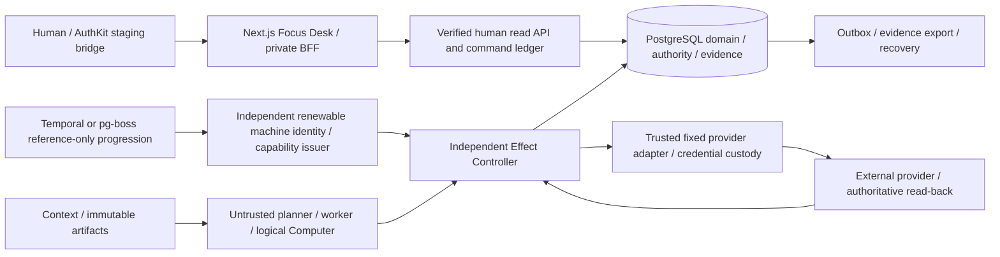

# Canonical implementation topology — approved responsibility split

No broad redesign. Asentxia is the institution; Continuum is the governed persistent environment; VERA is the durable accountable principal, not a model/session/machine/Computer.

The approved integration direction is NEXUS bounded execution and AEON-IQ governed
derived memory behind Continuum; see `plan/OWNER-DECISIONS.md`. That direction is
not implemented or qualified in the topology below. `plan/CURRENT-PLAN.md` keeps
adapter acceptance, separate application-workspace isolation and remaining live
gates explicit. PostgreSQL and the Effect Controller retain their responsibilities.

The console cannot dispatch, reconcile an external effect, renew a machine token, hold a provider-wide secret or become a capability issuer. Human approval records permission, not execution. Model/context data cannot grant authority. Domain truth is PostgreSQL; workflow progression belongs to the scheduler; external-world truth belongs to the provider. Schedulers use the same controller and remain unselected.

Fixtures intentionally use short-lived generated identities/test doubles. The integrated browser harness can co-host trusted fixture seams; it is not the production process-isolation topology. The accepted baseline separately exercises controller/process isolation. Managed VM, credentials, external anchors, production HA/DR and 24-hour operation remain unqualified.

Safety: immutable logical operation/digest, exact approvals/versions/fences, transactional admission and final-send checks, UNKNOWN with no blind resend, supported matching observation, conservative reservations, old-placement fencing and disabled restore activation. Frozen M1 bytes unchanged. Fixture-only manual control fences agents and hand-back leaves PAUSED; managed viewing/input remain unavailable.

## Authorized offline integration slice (2026-10-15)

The topology's earlier donor-status statement describes the original baseline.
The local sprint adds E2 credential-verifying ingress + PostgreSQL immutable receipts,
a narrowly adapted actual NEXUS/Wasmtime import-free native runner, and AEON's exact
request-local numeric ranking function behind R1 references and E2 admission.
They do not introduce facts/permissions/governance stores or donor public servers.
Generic console access does not expose E2 receipt records; owner inert review is
source-aware and explicitly authenticated. No live model/identity/external action
or qualified restore reopening is added. [Exact scope and limitations](integrations/LOCAL-IMPLEMENTATION.md).
The prior opaque computation contract remains recording/denial only; callers must
explicitly select the new local execution profile. Frozen authority/recovery and
Effect Controller ownership are unchanged. Public release/merge remain held.
