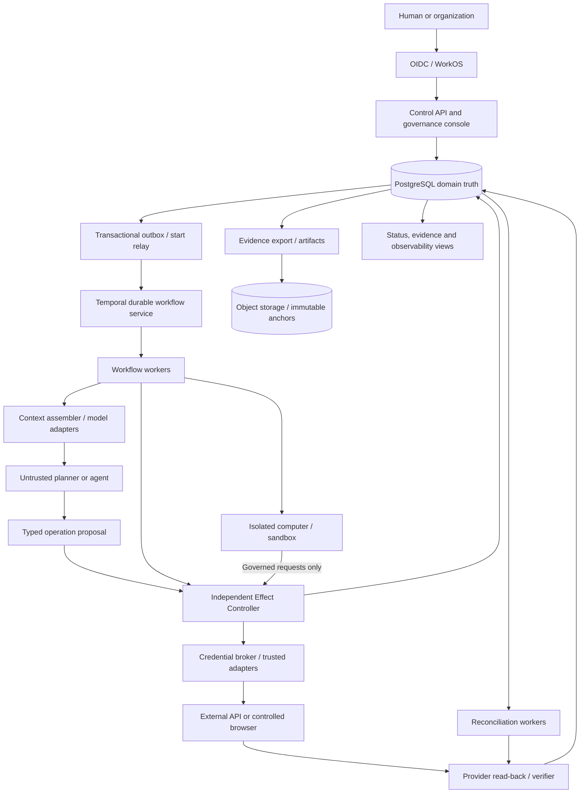

# CONTINUUM — Final Architecture Reconciliation & Synthesis

**Decision status: STRONGLY RECOMMENDED proposal, not canon, deployment approval or production certification.** No R2 was run. No existing system wins by age or naming; no R1 candidate wins by origin. Source inventory came first. Recommendations below apply to the requested end-to-end persistent agent system, not merely the narrower existing genesis proof.

## 0. Existing architecture/code/evidence inventory — starting point

The full pinned inventory and fresh test record are in <mention url="https://app.notion.com/p/980c0eb11815427a9fbe045443bed0a2">Existing Architecture, Code & Validation Inventory</mention>. Eleven public repository snapshots were inspected. Private `aether` and `nexus-planning` sources could not be accessed (404); their security/release claims are not cleared by this analysis. Current deployed revision, complete external R1 report, live cloud configuration and actual workload/cost envelope remain unavailable. The older add-on review is useful evidence, not a new run. [^https://app.notion.com/p/980c0eb11815427a9fbe045443bed0a2]

The evidence materially changes the starting assumption:

1. **Continuum is not yet one composed, proven stack.** Its Python/SQLite persistence proof, FastAPI/Mongo orchestrator, CRA operations UI, Vite mock and vendored component trees are distinct. The repository itself warns against treating component evidence as a composed product. [^https://github.com/Adaptive-Liquidity/Continuum/blob/9ac4723b5390d22ed2d6aed9cf984cb0a32731ca/docs/ARCHITECTURE.md]
2. **The persistence slice is useful but narrow.** This analysis reproduced its 15 tests and AC-1…AC-8. It demonstrates a clean same-host process restart and local mediated SQLite write—not abrupt crash recovery, external effect truth, host migration or production security. [^https://app.notion.com/p/980c0eb11815427a9fbe045443bed0a2][^https://github.com/Adaptive-Liquidity/Continuum/blob/9ac4723b5390d22ed2d6aed9cf984cb0a32731ca/docs/evidence/CURRENT_CLAIMS_AND_MATURITY_LEDGER.md]
3. **Staxions has reusable computer/provider/MCP code, not demonstrated full Continuum mediation.** The inspected predecessor service validates capabilities and paths, then calls provider exec/fs directly. Preserve those useful guards; do not mistake them for an independently enforced consequential-effect boundary. [^https://github.com/Adaptive-Liquidity/floks-pc/blob/08438f55b2081fd64e4aac1a0afaa5fc2c484845/src/lib/computers/service.ts#L847-L919]
4. **Continuum2 is a promising vocabulary/schema prototype, not a deployable safety implementation.** Its API leaves workflow invocation commented out; provider execution/read-back is simulated; its three original conformance checks are literal/example assertions. Fresh SQL and local-double reproductions identified tenant, approval, dispatch and binding defects. [^https://github.com/Adaptive-Liquidity/continuum2/blob/2501f879a57982edb24e79c30f00f68ccae5a545/apps/api-mcp/src/index.ts][^https://github.com/Adaptive-Liquidity/continuum2/blob/2501f879a57982edb24e79c30f00f68ccae5a545/conformance/test.spec.ts][^https://app.notion.com/p/980c0eb11815427a9fbe045443bed0a2]
5. **Neither scheduler makes remote effects exactly-once.** Actual Temporal and pg-boss passed the same eight bounded scenarios with the experimental shared effect controller. Removing the controller produced two local provider effects after a killed effect subprocess and retry in both engines. The provider was a local durable test oracle, not a real SaaS system. [^https://app.notion.com/p/980c0eb11815427a9fbe045443bed0a2]

### Evidence labels used throughout

- **PROVEN:** directly reproduced observation, restricted to its stated test scope. Never means the whole target is production-proven.
- **STRONGLY RECOMMENDED:** engineering choice supported by requirements, inspected code and primary-source behavior; still needs implementation and qualification.
- **NEEDS TESTING:** a concrete unknown with a required experiment/release gate.
- **UNRESOLVED:** missing owner policy, business/operational input, inaccessible artifact or a decision not supported by current evidence.

## 1. Executive verdict

**Build a small, PostgreSQL-centered governance system; integrate mature orchestration and mature isolated computers. Do not build another proprietary workflow engine, distributed actor fabric, virtual-machine platform, universal memory proxy or evidence blockchain.**

For the **full requested capability set**, the recommended default is:

> **Temporal for durable workflow progression + PostgreSQL for principal, authority, operation/effect and verification truth + an independent Effect Controller/credential broker + managed isolated computers + replaceable model/tool adapters.**

Keep DCA's useful responsibility distinctions as a coverage checklist. Keep VERA as a durable principal record and Continuum Computer as a logical environment record. They do **not** require seven microservices, a distributed identity network, or a permanently running machine/model. The existing DCA description already distinguishes principal from replaceable execution context; that semantic requirement is compatible with either finalist. [^https://app.notion.com/p/675325d1e2d54d95a57ff3e595318f5d]

**Why default to Temporal for the full target:** the requirements include multi-day jobs, waits, retries, cancellation, coordinated work and software changes during execution. Temporal supplies durable progression and worker-versioning machinery that would otherwise become proprietary infrastructure. Its documentation also explicitly requires idempotent activities; it does not replace the Effect Controller. [^https://docs.temporal.io/activity-definition][^https://docs.temporal.io/production-deployment/worker-deployments/worker-versioning]

**Why this is not an unconditional winner:** the real workload, team operation capacity and hosting/cost envelope are unknown. The bounded crash experiment tied; it did not measure production economics or long-running upgrade burden. PostgreSQL state machines + pg-boss remain a valid finalist for a deliberately bounded job model. DBOS is a credible PostgreSQL-backed durable-workflow alternative, but has not been qualified here. **The production scheduler choice is a validation gate, not a fabricated empirical victory.**

**Do not ship the current effect paths unchanged.** In the inspected Mongo code, UNKNOWN can be dispatched again; the wire adapter can fall back after an uncertain wire error. In the PostgreSQL prototype, approval is inferred from AWAITING_APPROVAL and dispatch lacks an expected-state guard. These are blockers independent of scheduler choice. [^https://github.com/Adaptive-Liquidity/Continuum/blob/9ac4723b5390d22ed2d6aed9cf984cb0a32731ca/backend/server.py#L384-L439][^https://github.com/Adaptive-Liquidity/Continuum/blob/9ac4723b5390d22ed2d6aed9cf984cb0a32731ca/backend/adapters/nexus.py][^https://github.com/Adaptive-Liquidity/continuum2/blob/2501f879a57982edb24e79c30f00f68ccae5a545/packages/effect-boundary/src/index.ts]

## 2. Recommended end-to-end architecture and comparison

### Target deployment boundaries

One repository and shared typed contracts; **three trust-separated deployment roles**, not seven business microservices:

1. **Control API:** tenant/principal/task registry, human governance, admission and read APIs. PostgreSQL domain modules are a modular monolith. OIDC login is integrated rather than invented.
2. **Workflow/agent workers:** Temporal workers coordinate tasks; model-planning and arbitrary code run with narrow read/context/proposal interfaces. Agents and untrusted workers have no database superuser, signing root, provider-wide credential or direct consequential egress.
3. **Effect Controller and trusted adapters:** independent authorization/admission, exact-action approval checks, durable effect records, credential custody, provider dispatch and reconciliation. Isolation and minimal privileges are real process/network/IAM boundaries, not just class names.

Use one domain PostgreSQL database initially. If self-hosting Temporal, its persistence database/user belongs to Temporal and is separate from domain tables. Temporal Cloud avoids running its service but introduces vendor/cost/residency choices requiring owner approval. A scheduler outage pauses progression; it never expands authority. A domain database outage stops new consequential admission.

### Candidate comparison

| Candidate | Correct role and strongest case | Principal cost/risk | Verdict |
| --- | --- | --- | --- |
| Current Continuum/DCA implementation | Preserve principal/authority/evidence semantics and bounded proof | Multiple storage/orchestration stacks; unsafe/untested effect paths; composition not demonstrated | MODIFY semantics; REPLACE unsafe execution implementation; not ready as-is |
| Temporal + PostgreSQL | Rich long-running workflows, durable waits/signals, joins, retries and versions; independent governance DB | Separate scheduling service/store and SDK/replay/version discipline; no magic external-effect atomicity | STRONGLY RECOMMENDED default for full target; qualification pending |
| PostgreSQL state machines + pg-boss | Few explicit business states, short or bounded queued phases, minimal operational footprint | Queue is not a complete workflow engine; team must not grow its code into bespoke replay/signals/versioning infrastructure | Viable finalist for bounded workloads; NEEDS TESTING at actual job complexity |
| PostgreSQL + DBOS | Durable workflows in existing TS/PG stack; fewer service types | Still requires deterministic workflows, step semantics and effect controller; qualification/migration/operations comparison absent | Serious alternative; NEEDS TESTING, not assumed equal maturity by assertion |
| AWS Step Functions + PostgreSQL/domain storage | Managed scheduling if deployment intentionally accepts AWS | AWS coupling, service limits and transition pricing; portability tradeoff | Conditional, UNRESOLVED owner dependence choice |
| Distributed actors/event fabric | A later hot partition or specialized high-concurrency coordination problem | Premature topology, supervision/placement/consensus burden; no demonstrated initial advantage | DEFER; not initial core |

AWS distinguishes Standard workflows (long-lived, transition-priced) from Express workflows (short-lived, different delivery semantics). These scheduler guarantees are not atomicity guarantees for third-party effects; accepting AWS dependence remains an owner decision. [^https://docs.aws.amazon.com/step-functions/latest/dg/choosing-workflow-type.html]

pg-boss uses PostgreSQL SKIP LOCKED for queue consumption. PostgreSQL says that mechanism is appropriate for queue-like tables but not a consistent general state view. It does not establish exactly-once external effects. [^https://github.com/timgit/pg-boss][^https://www.postgresql.org/docs/current/sql-select.html] DBOS documents recovery from completed steps, at-least-once steps and exactly-once database transactions; those are distinct from exactly-once third-party actions. [^https://docs.dbos.dev/typescript/tutorials/workflow-tutorial]

### Criteria and sensitivity

Retain the supplied weights: correctness 20%, recovery 20%, simplicity 15%, evolvability 15%, security 10%, small-team feasibility 10%, economics 5%, end-to-end performance 5%. **No numeric composite ranking is invented:** available experiments establish bounded behavior, not comparable cost/performance/team effort. A candidate failing a hard gate cannot be rescued by weighted scoring.

- **Scale S (~10 active agents):** managed computers, one API/Effect Controller deployment pair and one workflow pool; PostgreSQL may dominate simplicity. Long waits/branching complexity, not agent count alone, determines scheduler choice.
- **Scale M (~1,000):** pool workers, control sandbox concurrency, partition audit/operation tables, measure contention and workflow histories. Temporal becomes more compelling when jobs—not just concurrency—are complex.
- **Scale L (~100,000 scenario):** validate rates of active computation/effects, not just registered agents; introduce tenant/home-region shards only after measured pressure. No proof of this scale is claimed.
- **Managed multi-tenant:** managed PostgreSQL, Temporal Cloud if approved, managed VM isolation. **Self-hosted:** PostgreSQL + Temporal service, or validated DBOS/pg-boss if fewer moving parts is decisive. **Hybrid:** one tenant authority home; remote computers receive bounded execution capabilities, not independent authority masters.

## 3. Architecture diagram

**Trust boundary:** arbitrary shell/code and model-generated intent are outside the controller/credential/authoritative-storage trust domain. The computer's filesystem or process memory is not the source of identity, authority or remote-effect truth. The eight existing MCP tool names can remain compatibility adapters; no new wire protocol is needed to implement the target.

## 4. Exact stack and languages

| Layer | Recommended choice | Implementation constraint |
| --- | --- | --- |
| Core API, domain modules, Effect Controller, adapters | TypeScript on Node.js 24 LTS | Runtime schemas and strict TS; shared types are not runtime authorization |
| Workflow implementation | Temporal TypeScript SDK | Workflow code deterministic; external I/O in activities; stable logical operation IDs across retries/reset/Continue-as-New |
| Domain state | PostgreSQL 17, maintained minor release | Transactional relational state, JSONB only where useful; composite tenant keys; role separation; synchronous in-region HA and tested backups |
| DB access / schema changes | `pg` + Kysely where existing patterns help; versioned SQL migrations | Explicit transactions/locks/CAS in safety code; no hidden ORM retry of effect admission |
| Contracts | JSON Schema/OpenAPI + runtime validation; existing Zod contracts adapted | Signed/hashed semantic payload, not loosely typed `any` as policy input |
| Governance policy | Reviewed Cedar policies where useful + explicit DB checks | Cedar is policy evaluation, not grant freshness, spend reservation, credential custody or runtime containment |
| Human account login | Existing WorkOS/OIDC integration | Account authentication distinct from VERA identity and authority grants |
| Initial compute | Runloop VM-based devboxes through existing provider abstraction | External credential broker, default-deny egress, isolated principals/workloads; live qualification required |
| Alternative/self-hosted compute | Established VM/microVM sandbox provider | Integrate supported isolation; do not build a hypervisor; local containers only for trusted/dev tasks unless threat model validates them |
| Memory | PostgreSQL relational facts + full-text retrieval initially | pgvector only after retrieval-quality evidence; embeddings/indices rebuildable and non-authoritative |
| Evidence artifacts | S3-compatible object storage + PostgreSQL append records | Secrets redacted; digest/lineage; immutable anchors when required; retention owner-approved |
| Console | TypeScript/React/Next.js | Vercel acceptable for human UI; do not rely on request-lifetime functions for long-running workers or effect coordination |
| Observability | OpenTelemetry, structured logs, metrics/traces, Sentry as appropriate | Logs aid diagnosis; never substitute for provider verification |
| Bounded-job alternative | pg-boss rather than a proprietary queue | Mutually exclusive primary scheduler for a task; add no NATS/Redis/Kafka by default |
| Language exceptions | Rust for qualified reused NEXUS code; Python for existing tests/research/specialized adapters | No forced Rust/Python rewrite; no new Go core merely because an earlier target proposed Go |

**Why TS rather than inventing a new Go core:** Staxions and Continuum2 already have TypeScript interfaces/compute code; mature TS SDKs fit both scheduling finalists. There is no supplied measurement showing a language rewrite buys enough correctness or end-to-end performance to justify it. Keep the trusted controller small, explicit and testable. Python's existing proof remains valuable as a test, not as a reason to keep the Mongo demo as core.

The local test environment was Node 24.14.1, TS 5.9.3, pg 8.23.1, pg-boss 12.37.1, Python 3.13, psycopg 3.3.6 and Temporal Python SDK 1.34.0 on PostgreSQL 15.18. **That is not qualification of PostgreSQL 17 or the recommended TS Temporal adapter.** Pin their exact release versions/digests in engineering lockfiles and rerun the gates before deployment; untested patch numbers are not invented here.

Runloop documents VM-based isolation, snapshot/suspend/resume, network policies and credential-protecting gateways. That documents available mechanisms, not their correct configuration in this project. [^https://docs.runloop.ai/docs/devboxes/overview]

## 5. Data/state ownership map

| Data class | Authoritative owner | Allowed writers / identity | Recovery rule |
| --- | --- | --- | --- |
| Tenant, human ownership, VERA principal identity/status/epoch | PostgreSQL identity module | Owner/admin APIs; agent cannot grant itself identity authority | Logical IDs survive compute/model replacement; epoch fences stale credentials |
| Grants, policy versions, delegation, approvals, reservations | PostgreSQL authority module | Independent governance/controller role | Missing/stale/expired/revoked = deny; do not trust memory or a worker cache |
| Task identity, desired outcome, business phase | PostgreSQL task module | Admission and narrow authorized transitions | Stable task ID; distinguish desired business state from scheduler state |
| Workflow progression, timers/signals/retry history | Temporal-owned persistence/service | Temporal SDK/service | Temporal owns this state; PG projection is not a second execution engine |
| Operation and effect-attempt state | PostgreSQL Effect Controller | Trusted controller transition functions | Single logical operation; uncertain sent attempts require reconciliation |
| Actual external effect | External system/provider | Provider-controlled mutation | Receipt/read-back according to provider contract; otherwise UNKNOWN |
| Runtime placement / environment generation | PostgreSQL environment module | Trusted provider lifecycle adapter | Computer ID stable; new generation invalidates old placement authority |
| Agent context/memory facts | Versioned PostgreSQL memory records | Narrow tenant-scoped memory API | Provenance, confidence, expiry and corruption quarantine; cannot become authority |
| Embeddings, search caches, summaries | Rebuildable derived stores | Retrieval pipeline | May be discarded/rebuilt; original facts remain attributable |
| Code/files/checkpoints needed to resume | Object storage + referenced manifest in PG | Artifact service; bounded writes | Durable checkpoint manifests, digest checks; VM disk is not sole copy |
| Evidence sequence and decision records | PG append-only module; exported external anchors | Restricted append role | Atomic with relevant state transition; external archive detects later tampering |
| Telemetry/logs | Observability system | Instrumented services | Diagnostic/reconstructable; no claim of authoritative effect truth |

**Avoid the “one database owns every fact” overreach.** PostgreSQL owns domain facts; Temporal owns scheduling history; providers own external-world truth. They have explicit interfaces and independent recovery contracts. Evidence objects are not a second mutable decision source.

Minimum relational tables: tenants, humans, principals, computers, placements, grants, delegation_edges, policy_versions, approvals, tasks, operations, effect_attempts, observations, reconciliations, outbox, inbox, evidence_heads, evidence_events, context_items, artifact_manifests. Add resource reservations only where concurrency/spend constraints require them. Do not implement an arbitrary event-sourced engine merely to record an audit trail.

Enforce UNIQUE `(tenant_id, operation_id)` and `(tenant_id, provider, idempotency_key)` with payload-digest agreement. Composite foreign keys retain tenant identity across principal/task/grant links. Evidence append locks the per-tenant/shard `evidence_heads` row and allocates the next sequence transactionally; do not race `MAX(seq)+1` across writers. Use RLS defense-in-depth with non-owner roles and FORCE RLS where appropriate; untrusted workers still get no direct SQL credentials. PostgreSQL documents that owner/superuser/BYPASSRLS roles can bypass ordinary RLS. [^https://www.postgresql.org/docs/current/ddl-rowsecurity.html]

## 6. Complete execution lifecycle

1. **Agent intent / admission.** Authenticate the caller; derive tenant/principal from trusted auth, not request fields. Admit a task under a bounded mandate and attach a stable task ID. The initial check allows planning; it does not pre-authorize every future action.
2. **State/context.** Assemble tenant-scoped context from versioned facts/artifacts. Record a manifest of source IDs/digests/versions, model/tool/schema versions and memory confidence. Tag external/tool/memory text as data, not authority. No mutable memory field can widen a grant.
3. **Planning.** The replaceable model proposes typed steps and exact effect intents. Persist the plan/version. Validate schemas and resource constraints. Planning may be rerun safely; it cannot execute consequences directly.
4. **Operation identity.** Allocate a logical operation ID before dispatch. Bind principal, computer/generation, provider, action, exact resource, parameters digest, task/plan version, deadline and idempotency/natural key. A changed payload is a new/reapproved operation, never silent reuse of the same key.
5. **Authorization and approval.** Read current principal status/epoch, grant/delegation freshness, policy version, expiry, action/resource/constraint match and resource/spend reservation. If approval is required, store an owner-approved decision bound to the exact operation digest. AWAITING_APPROVAL is not approval; changed parameters invalidate it.
6. **Durable dispatch admission.** In one short PG transaction, lock relevant principal/grant/resource/operation records in a fixed order, recheck current policy and approval, CAS the expected state, write an effect-attempt/send reservation and append decision .artifacts/core/outbox. Commit before contacting the provider. The controller, not a model activity, owns this transition.
7. **Execution/computer/tool.** Computation runs in an isolated computer under a bounded placement lease. Consequential calls go to trusted adapters/credential broker. The agent never receives provider-wide tokens, database credentials or unrestricted network paths. A broker issues/consumes one tightly scoped permit or performs the request itself; random bytes are not a valid provider credential.
8. **Consequential action.** Before an actual send, the trusted dispatcher performs the current permit/admission check described in §7. Persist SENDING before remote I/O. Send a stable provider idempotency key where supported. Do not hold a DB transaction open over a slow provider request and claim it creates cross-system atomicity.
9. **Verification.** Classify acknowledgement correctly: HTTP accepted/queued is not necessarily completion. Store provider request/object IDs and observation. An independent read-back confirms the intended object/effect when the provider contract permits. A model statement, shell exit code, log or signature alone does not confirm remote truth.
10. **Durable update.** Append the observation/evidence and advance the domain operation using its expected version. Record COMMITTED only for a contractually authoritative acknowledgement/read-back. Track partial results individually. Workflow progress receives the operation result/reference, not authority.
11. **Recovery/reconciliation.** Missing completion after a possible send becomes UNKNOWN. A recovery activity asks the controller for current state or invokes read-back; it does not blindly resend. A provider-confirmed idempotent resend is permitted only under its contract, key retention window and renewed authority. Non-idempotent/no-readback operations stop for owner resolution.
12. **Continued operation.** Temporal records progression and schedules the next authorized phase. New workers/hosts assemble context from durable facts, not the old model's conversation. Change models explicitly; keep the principal ID. Continue-as-New carries stable task/operation references; it must not create new identities for old effects.

### State semantics

Keep separate fields for workflow progress, dispatch state, observed effect outcome and verification confidence:

- Operation flow: REQUESTED → PLANNED → AWAITING_APPROVAL or AUTHORIZED → DISPATCH_RESERVED → SENDING → observed outcome.
- Outcomes: COMMITTED, DENIED, FAILED_KNOWN_NO_EFFECT, UNKNOWN, PARTIAL, COMPENSATED, CANCELLED_BEFORE_SEND.
- UNKNOWN → RECONCILING → confirmed outcome or still UNKNOWN. **No automatic UNKNOWN → send.**
- TIMEOUT is an observation, not proof of failure; a timed-out sent action ordinarily remains UNKNOWN.
- Compensation is a new authorized operation with its own ID/evidence; it does not erase history or undo every external consequence.

The outbox/start relay bridges PG-to-scheduler without a distributed transaction: retrying “start workflow with task ID” returns the existing workflow or is reconciled. An inbox/dedup key handles repeated notifications. AWS's primary outbox guidance also warns that duplicates remain possible and consumers must be idempotent. [^https://docs.aws.amazon.com/prescriptive-guidance/latest/cloud-design-patterns/transactional-outbox.html]

## 7. Authority/security model

### Roots and enforceable boundaries

- **VERA:** durable accountable principal record, not its model, keys, runtime or host. OIDC authenticates a human; model/provider sessions do not define principal authority.
- **Regency:** governance domain modules and human console. Grant policy comes from authorized owners and independent enforcement. It is not another autonomous control loop or an eighth scheduling layer.
- **Effect Boundary:** the complete authorization → admission → credential → egress → execution → evidence contract, not just the Cedar evaluator or a route called `dispatch`.
- **Untrusted workers/agents:** can read authorized context and propose bounded operations. They cannot write grants, tenant context, effect completion or evidence truth directly.
- **Trusted adapter/broker:** minimum privileges per provider/action/tenant; secrets outside agent VM. Restrict network paths so a worker cannot bypass the controller using curl, a browser cookie, CDP or a provider SDK.

MCP account access is not operation approval. Validate token issuer/audience, tenant/resource ownership, token lifecycle and request scopes; use separate downstream credentials. Token passthrough is explicitly prohibited by MCP's security guidance. [^https://modelcontextprotocol.io/specification/latest/basic/security_best_practices]

### Revocation contract — honest, implementable semantics

Revocation and new dispatch admission must serialize on current authority records. Once revocation commits, **no later admission/permit may be granted using that authority**. Increment relevant epochs/versions, revoke descendants through checked ancestry, and cancel queued work. Detached bearer tokens with no online freshness check are insufficient for immediate revocation.

An effect admitted/sent before revocation may complete afterward. No generic application can guarantee that a request already in transit has been recalled. For stronger “no send after revoke” promises, the final trusted transport must serialize actual credential use with revocation (or use provider-supported cancellation/transactions), and that exact race must be tested. If an outage/crash makes the ordering unknowable, record UNKNOWN and reconcile. Do not call an asynchronous workflow-cancel signal an instantaneous global stop.

### Computers and browsers

A logical computer may be reconstituted on a new VM with a new placement generation. Generation fencing must be enforced by the broker/provider adapter; changing a row alone does not physically stop an old VM with stolen credentials.

A shell scope is powerful even without shell-string mode: arbitrary executable arguments can call network tools. Network containment and credential separation are mandatory. An authenticated browser's cookies are credentials; **never co-host a privileged browser profile/CDP endpoint with untrusted shell access** and call that read-only. Use a separately isolated trusted browser adapter, narrow account permissions and admitted action classes; risky UI effects need approval/read-back or remain UNKNOWN.

Tenant RLS is defense-in-depth for the trusted API, not permission for untrusted workers to set `app.current_tenant`. Add database role isolation, composite tenant foreign keys, protected migrations, test coverage for leakage and resource quotas. Keep signing/encryption keys in managed custody; immutable anchors cannot prove correctness, only detect some tampering.

### Threat and claim boundary

Compromise of one agent/ordinary worker must not expose other tenants or provider-wide authority. Compromise of the trusted controller, database administrator, broker or cloud root is a different threat: least privilege, isolated roles, independent archives/verifiers, key rotation and external audit reduce it; the architecture does not claim immunity. Prompt injection/memory corruption remains possible, but it cannot become authority merely by influencing planning.

## 8. Failure and recovery model

| Failure | Owning layer | Required behavior / release assertion |
| --- | --- | --- |
| Agent/planner process crash | Workflow + context service | Reconstitute from durable task/context; no dependency on conversation replay |
| Worker crash before effect admission | Scheduler | Retry safe computation/proposal; effect ID/payload binding stable |
| Crash after admission before send | Controller | Conservative UNKNOWN unless authoritative no-send proof exists; no blind replay |
| Crash after remote effect, before receipt | Controller + verifier | Read-back/idempotency-contract reconciliation; no unqualified resend |
| Duplicate queue/signal/MCP call | Admission/controller | Same logical ID returns current state; payload mismatch rejects |
| Concurrent execution of same operation | Controller/PG | CAS/locks/unique IDs admit one sender; stale attempts fenced |
| Tool timeout after successful effect | Verifier | TIMEOUT + UNKNOWN, then authoritative read-back |
| Authority revoked during execution | Governance/broker | Block subsequent admission, cancel best-effort; earlier in-flight effects may complete |
| Stale authority/principal epoch | Controller/broker | Deny, log reason; no renewal by agent |
| Credential rotation | Broker/identity | Rotate independent of logical principal; invalidate affected epoch and stale credentials |
| Model-provider outage | Workflow/model adapter | Circuit breaker, bounded retry/budget; approved replacement recorded; no effect fallback after uncertain send |
| Compute-provider outage / host loss | Environment service | Rebuild new placement from artifacts, increment generation; old placement cannot use broker |
| Network partition | Controller/scheduler | No offline grant widening; pause effect admission without authoritative checks |
| Database temporarily unavailable | Controller/PG | Fail closed on new effects; possible sent actions remain pending/UNKNOWN; do not mark FAILED by timeout |
| Database process crash | Database platform | WAL recovery; verify committed domain state and replay-safe outbox |
| Database loss / restore | Recovery owner/controller | Restore backup/WAL; block effects; rotate recovery/authority epoch; reconcile provider/evidence gap before resuming |
| Compromised agent | Sandbox/network/controller | No root keys, privileged browser, raw DB or unauthorized external path; revoke and isolate |
| Compromised ordinary worker | Narrow API/broker | Worker identity cannot choose another tenant or forge completion; compromised root service remains separate threat |
| Memory corruption / stale memory | Memory/context service | Digest/version check, quarantine, rebuild derived indices; authority still checked independently |
| Malicious tool response / schema change | Contract/context boundary | Validate version/schema; data cannot change policy; incompatible tools fail closed |
| Partial multi-day job | Workflow/controller | Per-step effect state, durable waits; resume remaining known steps; compensation separately authorized |
| Queue outage / duplication | Scheduler/outbox | Domain records remain durable; relay retries; no second execution authority |
| Runtime snapshot rollback | Environment/controller | Rollback local compute only; never erase a remote effect or replay it as new |
| Regional failure | DR owner + authority home | Fence old region, choose one authority writer, restore state; quarantine uncertain recovery window; no automatic active-active effects |
| Evidence writer race/tampering | Evidence module/archive | Transactional sequence allocation; external anchors/verification; never infer effect truth from chain validity alone |

PostgreSQL documents WAL-based crash recovery and backup+WAL point-in-time recovery; successful DR requires a tested continuous archive, not merely the presence of a backup file. [^https://www.postgresql.org/docs/current/continuous-archiving.html]

### Proposed recovery objectives — owner approval required

| State class | Proposed target | Important condition |
| --- | --- | --- |
| Acknowledged identity/grants/effect state/task domain state | RPO 0 for process/host/AZ failure in offered region; service RTO ≤15 min | Synchronous durable HA configured and failover drill passes; single-node smoke tests do not prove this |
| Workflow progression | RPO/RTO consistent with chosen Temporal deployment and domain target | Separate workflow-store recovery; do not reconstruct it by inventing successful effects |
| Regional DR | First propose safe-stop and RTO ≤4 h; RPO policy UNRESOLVED | If zero authoritative loss is required region-wide, fund synchronous cross-region/quorum durability. An async ≤5-min RPO option requires explicit owner acceptance; not silently called equivalent |
| Required artifact checkpoints | No loss of acknowledged checkpoint manifest/blob | Finalize blob before publishing manifest; verify copied digests |
| Derived memory/search indices | Rebuildable; proposed restore ≤24 h | Source facts retained; derived-state RPO may be weaker |
| Telemetry | Best-effort; proposed ≤24 h restore | No telemetry-durability claim substitutes for authoritative state |

A restored database can resurrect old grants or forget a completed effect. Therefore DR must bump a recovery epoch, invalidate old capabilities, preserve/recover external operation identities, and reconcile the lost/uncertain window before admitting effects. Until that drill passes, regional continuity is NEEDS TESTING, not a released guarantee.

## 9. Current component disposition — KEEP / MODIFY / REPLACE / MERGE / REMOVE / DEFER / NEEDS TESTING

This table covers the discovered current architecture and related component families. It does not pretend that inaccessible repositories or every vendored implementation were exhaustively audited.

| Component | Classification | Correct role / change and acceptance condition |
| --- | --- | --- |
| DCA seven responsibilities | KEEP / MODIFY | Coverage checklist; remove assumption that names imply topology or completed implementation |
| VERA | KEEP / MODIFY | PG principal identity/status/epoch and accountable ownership; no separate proprietary identity network |
| Continuum Computer | KEEP / MODIFY | Logical environment ID, placement generation and durable artifact references; not synonymous with VM |
| Regency Core | MERGE / MODIFY | Authority/policy domain modules in control plane plus checks in controller; no duplicate state master |
| Regency Console | KEEP / MODIFY | Human grant/revoke/approval/stop/evidence client; use reviewed existing UI patterns |
| Current Mongo orchestrator | REPLACE | Retain contracts/data for migration; retire as authoritative execution/control after parity; no rewrite masquerading as proof |
| Current Python/SQLite proof | KEEP | Bounded regression/evidence fixture; never production authority store |
| Current Vite mock and invented metrics | REMOVE from functional/proof path | Keep only as visual design asset if useful; no fictitious operational figures |
| Current CRA ops dashboard | MODIFY or REPLACE | Connect to read-only projections and governed APIs; not a second control root |
| PostgreSQL | KEEP / EXPAND | Domain truth; HA/roles/composite keys/backups; runtime workers cannot set arbitrary tenant SQL context |
| Continuum2 contracts/schema | MODIFY / NEEDS TESTING | Useful starting vocabulary; correct SQL, scope/approval/state checks and linkage; real integration suite required |
| Continuum2 simulated MCP/provider layer | REPLACE | Actual admitted workflow calls, real provider adapters, read-back and bounded credentials; no simulated COMMITTED |
| Effect Boundary | KEEP / REIMPLEMENT | Independent controller/broker/egress contract; repair UNKNOWN redispatch, races, fallback and audit sequencing |
| Temporal scheduling | INTEGRATE / NEEDS TESTING | Default for full long-running target; test TS adapter, version upgrades, waits, host loss and deployment burden |
| PostgreSQL business state machines + pg-boss | KEEP as alternate / NEEDS TESTING | Bounded explicit phases; integrate mature queue, not a generic new workflow engine |
| DBOS coordinator idea | NEEDS TESTING / DEFER as production choice | Qualify durable step behavior and ops advantage; mere dependency/comment is not integration |
| Staxions computer service / Runloop adapters | KEEP / MODIFY / NEEDS TESTING | Reuse lifecycle/tools/path guards; route consequences through controller; prove no-bypass live path |
| Provider-wide secrets inside runtime / direct privileged egress | REMOVE | Broker custody and network enforcement; deny by default |
| NEXUS full proprietary runtime | DEFER / NEEDS TESTING | Not required for core; isolate optional WASM workload only if measured advantage over Wasmtime/provider integration |
| NEXUS capability/receipt patterns | MODIFY / selectively MERGE | Review useful contracts; signed receipts prove integrity, not real-world success |
| NEXUS egress/URL guard | NEEDS TESTING | Inspect unresolved wiring/security; do not treat a policy file as enforced network control |
| AEON-IQ whole proxy / memory service | DEFER / MODIFY | Reuse qualified storage/retrieval ideas behind one explicit memory API; do not auto-inject all memory or add a second state master |
| Memory | KEEP / SIMPLIFY | Attributable facts + context manifests; add vectors only after retrieval/deletion/tenant tests |
| Genesis authority/identity routines | MODIFY / selectively MERGE | Reuse reviewed attenuation/lease semantics; replace in-memory authority master with PG; no automatic network identity requirement |
| AEON Program / on-chain authority / economy | DEFER / REMOVE from core | Only a separately justified business requirement can add chain dependence |
| Context Kernel | DEFER / NEEDS TESTING | Simulator/test research until independent failed S0 audit is resolved; no production trust dependency |
| Evidence / Proof Capsules / Nexus-IQ packaging | MERGE / MODIFY | One evidence contract, artifact manifest and verification/export pipeline; no duplicated truth stores |
| Recovery/reconciliation | KEEP / BUILD domain semantics | Shared provider-aware controller; no scheduler-local blind retry or local snapshot-as-remote-undo |
| Agent-Bridge | MODIFY / MERGE or DEFER | Reuse reviewed scoped messaging/approval patterns; no autonomous grant expansion or second scheduler |
| Control Room | MODIFY / MERGE relevant UI patterns | Exact-revision approvals and audit views; not core authority until integrated and tested |
| noema-gateway / model routing | MERGE / SIMPLIFY | One replaceable model/tool adapter layer; no routing fabric on day one |
| aeon-lab workflows and release gates | KEEP as references / MODIFY | Reuse bounded phases and policy gates; confidence/quality gates do not replace authorized human approval |
| Machine interfaces | KEEP / MODIFY | Existing MCP compatibility + explicit OpenAPI/domain operations; no new protocol just to express the architecture |
| Multi-agent collectives/organizations | DEFER elaborate topology / KEEP minimal coordination | Explicit task ownership, delegation and scoped inboxes; shared chat never merges authority |
| Kafka/NATS/Redis/event fabric / actor fleet | DEFER | Add for measured transport/cache/partition need, never as second authoritative effect store |
| Custom hypervisor / cross-provider VM checkpoint format | REMOVE from MVP / DEFER research | Mature VM isolation and logical-state rebuild meet initial requirement more directly |
| Immutable evidence ledger / new consensus or blockchain | REMOVE from core | Conventional transactional audit + object storage/anchors where justified |
| Historical duplicated vendored package trees | MODIFY / REMOVE duplication after licensing review | Pin reviewed dependencies or owned modules; preserve provenance/licenses, not parallel live services |

NEXUS's audit file explicitly says no formal external audit, and its URL guard retains a wiring TODO. Genesis describes bounded in-memory R0–R2 with R3 not started. The context kernel declares an audit gate failure/correction candidate. Those facts prohibit automatic promotion merely because the code exists. [^https://github.com/Adaptive-Liquidity/Nexus-temp/blob/e1c3d3c75d58f609c617e7a87cb05e84ea437d64/AUDIT.md][^https://github.com/Adaptive-Liquidity/Nexus-temp/blob/e1c3d3c75d58f609c617e7a87cb05e84ea437d64/src/security/url_guard.rs#L119][^https://github.com/Adaptive-Liquidity/genesis-runtime/blob/dfd9c69a45302034a41e997f03655c0452e93010/README.md][^https://github.com/Adaptive-Liquidity/aeon-context-kernel/blob/dbea6a2f30725609c0216b6c05e13a4fc146b6de/README.md]

## 10. R1 reconciliation and prior-target handling

Record R1 exactly as directed:

**Independent restricted-input architecture analysis; useful evidence, but not fully clean-room certified because ambient session context existed.**

Preserved substantive findings, supplied by the owner:

- No unconditional winner.
- Temporal + PostgreSQL and PostgreSQL-backed state machines remain the strongest independent finalists.
- Distributed actors were excessive for the initial system.
- AWS-managed architecture is conditional on accepting AWS dependence.

**Limitation:** the full external report/input/response artifact has not been inspected here. No scores, citations, reasoning or test results are attributed to R1 beyond those four supplied findings. This reconciliation is not a replacement “independent R1.” No R2 is launched merely to preserve blindness.

R1 and existing DCA are not mutually exclusive: one is a technology/topology analysis; the other supplies responsibilities and invariants. The synthesis preserves needed semantics and replaces unjustified implementations. Historical TARGET-V1.0 advocated a custom lean PG durable engine and a Go core; neither receives protected status. This proposal instead integrates mature scheduling and favors the existing TS ecosystem unless testing proves a reason to change language.

## 11. Build versus integrate decisions

| Capability | Decision | Why ownership is or is not justified |
| --- | --- | --- |
| Principal/accountable identity mapping | BUILD small domain module | Product semantics and lifecycle; use OIDC/standard cryptography underneath |
| Grants, exact-action approvals, delegation/freshness/budget rules | BUILD thin domain logic; INTEGRATE policy engine | These encode actual governance; do not invent a new language or identity crypto |
| Effect Controller/provider contracts/reconciliation | BUILD narrow domain adapters | No generic scheduler knows the provider's authoritative success/absence or this owner's authority rules |
| Workflow engine, timers, replay, worker versions | INTEGRATE Temporal; qualify alternatives | Mature infrastructure supplies the mechanism; no demonstrated proprietary advantage |
| Bounded task queue | INTEGRATE pg-boss if that candidate is chosen | Avoid queue implementation and broker proliferation |
| Database, HA, backup/WAL restore | INTEGRATE PostgreSQL and managed ops | Domain tables owned; storage engine/replication not rebuilt |
| Compute/VM isolation | INTEGRATE managed provider / supported VM runtime | No measured need for proprietary hypervisor |
| Memory | BUILD explicit ownership/provenance/query API; INTEGRATE storage/search | Avoid universal memory auto-injection and redundant database |
| Evidence | BUILD schema/lineage/verification semantics; INTEGRATE storage/signing/telemetry | Signatures/archive are mature; truth and authorization are domain contracts |
| Multi-agent messaging | INTEGRATE scheduler/scoped inbox patterns | Build minimal delegation/resource coordination; no new federation protocol |
| Model/tool gateway | INTEGRATE provider SDKs/MCP; BUILD minimal abstraction | Replaceability needed; generalized router marketplace not demonstrated |

Gate G6 applies to each BUILD. Only domain semantics that cannot be adequately supplied by integration justify ownership. A product-specific table/adapter is not a mandate to build proprietary infrastructure. Evaluate the eight hard gates independently: durable state, no blind uncertain retry, external authority, non-model isolation, defined recovery, mature-infrastructure preference, proportional complexity and authoritative external truth. The design addresses them; **implementation clearance remains conditional on the tests below.**

## 12. Components that should not exist in the recommended initial core

- Seven separately deployed services simply to match seven DCA responsibility names.
- A proprietary general-purpose workflow/replay/timer engine.
- An actor/consensus/event-log fabric without an observed workload advantage.
- A second writable authority/effect store in Mongo, agent memory or a VM.
- A “verified effect” shortcut based on model text, seed data, simulated receipt, a hash chain or zero exit code.
- Provider-wide credentials or privileged browser sessions reachable from arbitrary agent shell.
- Automatic fallback/retry to another executor/provider after an uncertain consequential send.
- A custom hypervisor, network protocol, identity blockchain or on-chain economy as core dependencies.
- Multiple imported memory proxies, approval engines, evidence ledgers and orchestrators doing overlapping jobs.
- A mandatory NEXUS/AEON-IQ/Context Kernel dependency solely because it is in the portfolio.

These are removal-from-target decisions, not authorization to delete repositories, destroy historical artifacts or alter commercial positioning.

## 13. MVP architecture

**Smallest MVP meeting the full requested direction:** one tenant initially; one logical computer/principal; one mature scheduler; one isolated execution provider; one real consequential provider adapter; exact-action human approval; explicit UNKNOWN/reconciliation; no multi-region active-active or actor fleet.

Default MVP units:

1. TypeScript Control API + human governance console.
2. PostgreSQL domain DB with corrected schema, roles, CAS/locks, outbox, evidence and backups.
3. Temporal service (managed if approved) + one TS worker pool; run-scoped workflows, not one permanent workflow per principal.
4. Independent Effect Controller + credential-broker/provider adapter; isolated network/identity from planner.
5. One managed Runloop computer with durable artifact export and generation fencing.
6. Minimal versioned memory/context API and object storage.
7. Provider read-back and operator evidence view.

Pick a real adapter with a safe test environment and authoritative read-back (for example, create a draft object in a dedicated test repository); the existing simulated GitHub adapter does not qualify. Do not run the paid/live proof without owner approval.

**Bounded proof alternative:** if the owner deliberately accepts a small fixed phase graph and no rich workflow/versioning requirement at launch, use pg-boss with PG business states instead of Temporal. Do not run both as masters of the same task. If adding pause/resume/joins/long-running version handling requires a generic homegrown engine, stop and adopt Temporal or a qualified DBOS implementation. This smaller mode is not permission to claim all long-running capability has been established.

## 14. Scale-up architecture and triggers

| Trigger (proposed; not measured facts) | Evolution |
| --- | --- |
| Queue/start-to-run p95 misses agreed SLO, or controller admission p95 >250 ms under required workload | Profile DB/connection/lock/provider contention first; tune concurrency/indexes; add worker pools, not a new fabric automatically |
| Audit retention or write volume materially affects operational queries | Partition .artifacts/core/observations by tenant/time, export archives; maintain transactional append contract |
| Multi-day workflows must survive deployments, human waits or parallel joins | Temporal qualification/adoption becomes required unless an alternative passes the same tests with less total burden |
| Bounded PG implementation grows generic replay/timer/signal/version subsystems | Reject proprietary engine; replace orchestration with mature workflow runtime |
| Per-tenant hot shard exhausts measured PG capacity | Assign tenant home/shard and split controller/storage along tenant boundaries; no cross-shard grant transaction by assumption |
| Sandbox cost dominates per-task cost or burst limit misses SLO | Benchmark provider alternatives/pooling/suspend; checkpoint logical state; do not fabricate snapshot portability |
| Customer self-hosting/data residency is required | Package supported self-hosted PG+scheduler+adapter profile; validate no managed-only dependency |
| Regional availability objective requires zero authoritative loss | Fund and test suitable cross-region durability/fencing; otherwise offer explicit safe-stop DR rather than pretending RPO 0 |
| Genuine high-rate independent entity coordination outgrows workflows | Trial actors for that isolated problem only; authority/effect truth remains stable |
| Retrieval quality fails defined real-task benchmark | Compare FTS, pgvector and qualified AEON-IQ subset; measure leakage/deletion/latency and usefulness |

Thresholds are proposed engineering triggers to refine against SLO/budget, not new frozen business facts. Architecture should evolve by replacing adapters/scaling partitions, not redefining VERA IDs or losing operation histories.

## 15. Required validation tests — decisive, not ceremonial

### Tests already performed

See <mention url="https://app.notion.com/p/980c0eb11815427a9fbe045443bed0a2">Inventory and Validation</mention> and the downloadable test bundle. Original source was unchanged. Existing bounded proof: 15 tests/AC-1…8 passed. Diagnostic reproductions: six Mongo-function checks, five original-schema SQL checks, five TS grouped observations. Actual paired schedulers: eight safe scenarios each; unsafe direct retry created two local effects each. **Diagnostic “pass” means defect reproduced, not product safety cleared.** [^https://app.notion.com/p/980c0eb11815427a9fbe045443bed0a2]

### Smallest decisive Temporal-versus-PostgreSQL selection spike

Implement the same domain/controller interface once; swap only orchestration. Use real chosen production-major PostgreSQL, TS Temporal SDK and pg-boss; add DBOS as a third arm only if its lower-service count is an owner priority. The supplied local probe is a seed, not the decisive production trial.

| Test | Minimum experiment and required evidence |
| --- | --- |
| Durable wait/approval | 24-hour approval wait (accelerated for unit tests, real wait in soak), kill whole worker/host, resume; expired/revoked grant must not act |
| Branch/join and partial job | Representative 10-step and multi-branch job; a partial result, retry, approved compensation and explicit unresolved effect |
| Workflow upgrade | Start v1, deploy incompatible v2, resume old work using supported version policy; show no old effects reissued |
| Abrupt compute/scheduler failure | SIGKILL entire worker, restart scheduler process, loss of runtime host; repeat at every controller boundary |
| Actual provider uncertainty | Safe provider sandbox with delayed/accepted/committed/lost-ack cases; independent read-back oracle and key expiry/retention controls |
| Tenant and authority race | Two tenants, two concurrent workers, revocation/expiry/epoch/approval changes racing final dispatch; zero unauthorized sends |
| Database failover/restore | Primary kill/promotion and PITR from backup; recover authority/operation gap before resume; demonstrate no resurrected revoked capability |
| Operational burden/cost | Record implementation hours, code owned, services/runbooks, recovery toil, infra/request costs at agreed S/M workload and p95 completion latency |

**Decision rule:** correctness/security gates first, then unchanged weights. If bounded PG+pg-boss meets representative behavior with materially lower total ownership burden, choose it for that scope. If it needs hand-built generic workflows or fails wait/version/partial-job recovery, choose Temporal. DBOS wins only after the same uncertainty/upgrade/tenant/restore tests demonstrate an actual burden advantage. Record raw results; do not award synthetic 7.9/6.5 scores.

### Release gates for the complete target

1. **No-bypass:** with arbitrary shell, SDK, curl, browser/CDP, DNS/IP/redirect and SSRF attempts, protected provider/DB/metadata endpoints cannot be reached outside admitted adapters. Verify live network enforcement; config text is insufficient.
2. **Race/fault battery:** crashes at before/after admission, before send, provider commit, receipt, evidence and scheduler acknowledgement; repeated/parallel delivery; bounded states or confirmed read-back, never blind uncertain replay.
3. **Grant correctness:** grantee/tenant/action/resource/expiry/delegation/approval/policy/epoch/budget match; descendant revocation and final-send ordering tested. No authority widened by planner or ordinary worker.
4. **Memory integrity:** poison/corrupt/stale context, cross-tenant recall, deletion/export and changed embedding model. No memory item becomes an authorization fact.
5. **Evidence truth:** fake receipt/model claims/seed success are rejected as proof; hash-chain forks/tampering detected; provider truth mismatch stays UNKNOWN.
6. **Computer loss:** destroy—not just suspend—the runtime host; reconstruct from manifest with new generation; old host credentials/requests denied.
7. **Regional DR:** isolate old region, restore/promotion, rollback authority state and missing external effects. Single authority home and recovery epoch; prove advertised RPO/RTO or keep claim unapproved.
8. **Compromise tests:** agent and ordinary worker compromise, tenant switching, stolen stale permit, API parameter tampering and privileged-browser access; containment validated.
9. **Resource/SRE:** limits on active computes, token/tool spend, storage, pending work, retry storms and queue starvation; report denied vs delayed vs exhausted distinctly.
10. **Independent security review:** inspect trusted controller/credential/network boundaries and inaccessible NEXUS findings before production dependency. No component gets an audit pass from this architecture report.

## 16. Migration plan from current implementation

| Stage | Action | Exit gate / rollback |
| --- | --- | --- |
| M0: inventory freeze | Identify actual deployed Staxions/Continuum revisions, credentials, data stores and endpoint exposure; retain all old artifacts/pins | Owner confirms live inventory; no rename/destructive change |
| M1: safety contract | Freeze operation/approval/grant/UNKNOWN semantics, tenant keys and adapter verification contracts | Tests specify expected state for every failure; simulated-success path explicitly dev-only |
| M2: PostgreSQL foundation | Correct Continuum2 schema; composite tenant constraints, proper role context, evidence-head locking, transactions/CAS, real approvals | Real DB integration and RLS/worker-isolation tests; initial no-effects environment |
| M3: read-only migration | Export Mongo/JSON/capability metadata; map existing IDs to stable principal/computer IDs; preserve hashes/history | Reconcile row counts/ownership/IDs; old and new read-only comparison; no dual writable authority |
| M4: controller | Implement trusted adapter/broker/verification; remove UNKNOWN redispatch and uncertain transport fallback; no agent-held privileged secrets | Local and safe-provider fault/race/no-bypass gates pass; independent review |
| M5: scheduler decision | Run the decisive spike; adopt one mature engine and pin SDK/service versions | Recorded criteria/results; no custom workflow engine slips in |
| M6: shadow | New planner/workflow calculates decisions without sending; compare with current execution logs/authoritative provider objects | Mismatches investigated; shadow system cannot mutate providers |
| M7: single-principal canary | Freeze old dispatch for chosen tenant, revoke/rotate old credentials, advance generation/epoch, enable new sole controller | Real approved action/read-back, killed worker recovery, revocation and evidence pass |
| M8: progressive tenant cutover | Move tenants with explicit authority home; retain legacy read-only archive and ID mapping | Rollback can stop new admission; it must never reactivate stale old controller credentials |
| M9: retirement | Stop old authoritative Mongo/orchestrator/JSON-write paths and duplicate services after parity/export verification | Evidence/identity access retained; source deletion/licensing/product renames need separate approval |

**No naive dual-write cutover.** A migration failure pauses both possible senders until authority is unambiguous. Rollback restores control-plane availability, not stale authority or replay of completed effects. Previously exposed credentials may require re-enrolment; never migrate plaintext secrets from artifacts into agent-visible storage.

## 17. Remaining owner decisions

1. Obtain the full R1 artifact and actual deployed code/cloud inventory for final traceability; this does not require a blindness-preserving R2.
2. Confirm initial job complexity, launch scale and team capability; these determine Temporal vs bounded PG/DBOS fit.
3. Approve managed Temporal Cloud vs self-hosting, budget/residency and provider dependence. No paid integration was launched here.
4. Set actual availability/RPO/RTO, especially region-wide authoritative-loss tolerance and safe-stop behavior.
5. Define revocation promise: block new admission vs stricter final-send guarantee for supported providers; acknowledge in-flight effects cannot universally be recalled.
6. Choose real initial consequential action and verification oracle; define which irreversible/financial actions need explicit approval and what remains prohibited.
7. Confirm sandbox/host threat model, allowed network destinations, privileged browser scope and provider credential model.
8. Set .artifacts/core/memory retention, redaction/deletion obligations and approval/audit access.
9. Resolve canonical repository/version, licensing and vendored-code ownership; restore access to private security findings if those components are candidates.
10. Decide commercial role/naming of Staxions, Regency and Continuum independently of this implementation topology. No canon is changed by the recommendation.

## RECOMMENDED CONTINUUM TARGET ARCHITECTURE

**A TypeScript modular control plane with PostgreSQL domain truth, Temporal durable orchestration as the full-target default, a genuinely independent Effect Controller/credential broker, managed isolated computers and explicit provider verification/reconciliation.**

**Keep** VERA, logical computers, external authority, attributable memory, evidence and uncertainty semantics. **Replace** unsafe/mock execution paths and duplicate authority stores. **Integrate** databases, scheduling and sandbox infrastructure. **Defer** actors, custom hypervisors, mandatory WASM/memory platforms, chain economics and elaborate collectives until a measured requirement justifies them.

**PROVEN:** bounded source observations, existing same-host proof and local experiments described above. **STRONGLY RECOMMENDED:** the target and trust/data ownership contracts. **NEEDS TESTING:** production scheduler qualification, live no-bypass/provider behavior, failover/DR/tenancy and memory. **UNRESOLVED:** owner budget, live deployment, region policy, complete R1 artifact and inaccessible security evidence. No unconditional empirical scheduler winner or production-readiness claim is made.

RECOMMENDED CONTINUUM TARGET ARCHITECTURE
